<!-- header:start -->
<div align="center">


<a href="#-quick-start"></a>

<a href="LICENSE"></a>

<a href="https://github.com/ajendras/hintforge/stargazers"></a>
<a href="https://github.com/ajendras/hintforge/actions/workflows/ci.yml"></a>

<a href="CONTRIBUTING.md"></a>

**AI-powered contextual password recovery for ZIP, RAR, PDF, 7z, TAR and Office (docx/xlsx) documents**

[✨ Features](#-features) • [⚡ Quick start](#-quick-start) • [🧰 Usage](#-usage) • [🧩 Architecture](#-architecture) • [📍 Roadmap](#-roadmap) • [🤝 Contributing](#-contributing)

</div>
<!-- header:end -->

## ✨ Why HintForge?

People regularly forget passwords to their own archives. Brute-force and plain dictionary attacks are too slow or ineffective against modern encryption. HintForge fills the gap by using a local LLM (via Ollama) to convert vague user memories like "my dog + birth year" into intelligently ranked password candidates.

- **Context Oracle**: `generate_candidates()` turns natural-language hints into high-probability candidates using local models
- **Hybrid intelligence**: Combines AI guesses with `DictionaryStrategy`, `MaskStrategy` and rules before testing
- **Multi-format support**: Native handling for ZIP, RAR, PDF, 7z, TAR and Office (DOCX/XLSX) via `handlers.detect_format()` and `open_with_password()`
- **Safe & resumable**: Dry-run mode, non-destructive `try_password()`, session checkpoints in `.hintforge/`, and strength analysis
- **Brutalist live UI**: Real-time progress, ETA and chunky neo-brutalist panels built with Rich

## 🎬 Demo

<p align="center"></p>

## 🚀 Features

<table>
<tr>
<td>
🧠 <b>Context Oracle</b><br>
Local LLM converts hints into ranked <code>Candidate</code> objects
</td>
<td>
📦 <b>Multi-Format</b><br>
Native support for ZIP, RAR, PDF, 7z, TAR and Office (DOCX/XLSX) documents
</td>
<td>
🔀 <b>Hybrid Attacks</b><br>
<code>run_strategy("hybrid")</code> merges AI, dictionary and mask candidates
</td>
</tr>
<tr>
<td>
📊 <b>Likelihood Ranking</b><br>
Scores candidates by LLM likelihood before expensive testing
</td>
<td>
📈 <b>Live Progress</b><br>
Neo-brutalist Rich UI with ETA, rate and chunky panels
</td>
<td>
🧩 <b>Pluggable Strategies</b><br>
Easy-to-extend <code>BaseStrategy</code> subclasses and registry
</td>
</tr>
<tr>
<td>
🛡️ <b>Safe Testing</b><br>
<code>--dry-run</code> and non-destructive validation via <code>tester.py</code>
</td>
<td>
⏳ <b>Session Resume</b><br>
Checkpoint/restore with <code>SessionState</code> JSON files
</td>
<td>
🔎 <b>Strength Analyzer</b><br>
<code>analyze()</code> reports encryption strength and recommends strategy
</td>
</tr>
</table>

## 📦 Installation

Requires Python 3.9+ and a running Ollama instance with a model such as `llama3`.

```bash
pip install git+https://github.com/ajendras/hintforge.git
ollama pull llama3
```

The CLI is automatically installed via the `hintforge` entrypoint defined in `pyproject.toml`.

## ⚡ Quick start

```bash
hintforge recover archive.rar --hint "vacation 2022 and pet name" --model llama3
```

Or use the Python API exposed in `src/hintforge/__init__.py`:

```python
from hintforge import recover

password = recover(
    archive_path="protected.zip",
    hint="my dog max born in 2019",
    model="llama3",
    max_candidates=75,
    dry_run=False,
    resume=False
)
print(password)
```

## 🧰 Usage

Generate candidates only (no archive required):

```bash
hintforge generate --hint "family vacation greece 2018" --count 40 --model llama3
```

Analyze encryption strength and get a recommendation:

```bash
hintforge analyze backup.7z --format 7z
```

Basic recovery with resume support:

```bash
hintforge recover documents.zip \
  --hint "our wedding year and dogs name" \
  --max-candidates 120 \
  --resume
```

<details><summary>Advanced: custom config and strategy control</summary>

Create a `config.toml` (loaded by `utils.load_config()`):

```toml
model = "llama3"
max_candidates = 100
temperature = 0.7
enabled_strategies = ["ai", "dictionary", "mask"]
min_score_threshold = 0.3
```

Then run a hybrid strategy directly from Python:

```python
from hintforge import run_strategy, Candidate, Config
from hintforge.models import Candidate

config = Config(max_candidates=50, model="llama3")
seed = [Candidate(score=0.9, value="Max2019!")]

candidates = run_strategy(
    strategy="hybrid",
    hint="our dog max vacation 2019",
    candidates=seed,
    config=config
)
print([c.value for c in candidates[:5]])
```
</details>

## 🔧 Configuration

| Option                | Default     | Description                                      |
|-----------------------|-------------|--------------------------------------------------|
| model                 | llama3      | Ollama model name (must be available locally)   |
| max_candidates        | 75          | Maximum candidates to generate and test          |
| temperature           | 0.75        | LLM temperature for candidate diversity          |
| top_p                 | 0.9         | Nucleus sampling parameter                       |
| enabled_strategies    | ["ai", "dictionary", "mask"] | Strategies used in hybrid mode |
| dictionary_path       | None        | Optional custom wordlist path                    |
| min_score_threshold   | 0.25        | Discard candidates below this score              |

All values are defined in `models.Config` and loaded from `config.toml` by `utils.load_config()`.

## 🧩 Architecture

```mermaid
flowchart TD
    CLI[cli.py<br>recover / analyze / generate] --> Core[core.py<br>recover() + analyze()]
    Core --> Oracle[oracle.py<br>generate_candidates()]
    Oracle --> Ollama[(Ollama<br>llama3)]
    Core --> Strategies[strategies.py<br>run_strategy("hybrid")]
    Strategies --> AIStrategy[AIStrategy]
    Strategies --> DictionaryStrategy[DictionaryStrategy]
    Strategies --> MaskStrategy[MaskStrategy]
    Core --> Tester[tester.py<br>try_password()]
    Tester --> Handlers[handlers.py<br>detect_format() + open_with_password()]
    Core --> Session[(SessionState<br>.hintforge/*.json)]
    Core --> Utils[utils.py<br>brutalist UI + config]
    Handlers --> ZIP[RAR/PDF/7z/TAR/OFFICE handlers]
```

The orchestrator in `core.py` coordinates the Context Oracle, pluggable strategies, tester facade and session persistence. All data flows through Pydantic `Candidate` and `Config` models, keeping the pipeline type-safe, resumable and easy to extend.

## 📁 Project structure

```text
.
├── pyproject.toml                 # Metadata, dependencies, console_scripts entrypoint
├── config.toml                    # Default model, temperature, strategies, paths
├── src/hintforge/
│   ├── __init__.py                # Public API: recover, analyze, generate_candidates, run_strategy, Candidate
│   ├── cli.py                     # Click commands + neo-brutalist Rich UI (_brutalist_header, HEAVY boxes)
│   ├── core.py                    # Orchestrator: recover(), analyze(), session handling
│   ├── oracle.py                  # Ollama integration, JSON parsing, _parse_llm_response()
│   ├── strategies.py              # BaseStrategy, AIStrategy, DictionaryStrategy, MaskStrategy, run_strategy()
│   ├── tester.py                  # try_password(), format-specific _test_* helpers
│   ├── handlers.py                # detect_format(), open_with_password(), PasswordError (now with Office)
│   ├── models.py                  # Pydantic models: Candidate, Config, SessionState, Job
│   └── utils.py                   # load_config(), save_session(), brutalist_panel(), sanitize_password()
├── tests/
│   ├── test_oracle.py             # Mocked Ollama responses and scoring tests
│   └── test_tester.py             # Unit + integration tests with fixture archives
├── examples/recovery_demo.py      # Runnable full-workflow example with test RAR
└── LICENSE
```

## 🧪 Testing

```bash
pytest -q
```

Tests cover candidate generation (mocked Ollama in `test_oracle.py`), password testing with real fixture archives (`test_tester.py`), core orchestration, strategy merging, format detection and session serialization. Run with the `[test]` extra.

## 📍 Roadmap

<!-- roadmap:start -->
- [x] **v0.1.0** — first release: Context Oracle, Multi-Format, Hybrid Attacks, Likelihood Ranking
- [x] Add Office document (docx/xlsx) handlers
- [ ] Hashcat integration for GPU-accelerated mask and rule attacks
- [ ] Simple brutalist web dashboard for job monitoring
- [ ] Auto-extract context from filename, nearby files and EXIF
- [ ] Session export/import for sharing recovery state
- [ ] Built-in password strength estimator with crack-time projection
- [ ] Plugin system for user-supplied Python generators
- [ ] Parallel testing using ProcessPoolExecutor
- [ ] Support for 7z and OpenSSL-encrypted TAR files
- [ ] Verbose logging and JSON result export
- [ ] Pre-built common wordlists with frequency ranking
- [ ] Interactive hint refinement loop based on partial matches

> 🤖 This roadmap is worked through continuously — ideas and PRs welcome!
<!-- roadmap:end -->

## 🤝 Contributing

We love loud, chunky contributions! Please read [CONTRIBUTING.md](https://github.com/ajendras/hintforge/blob/main/CONTRIBUTING.md) and adhere to our [Code of Conduct](https://github.com/ajendras/hintforge/blob/main/CODE_OF_CONDUCT.md).

PRs improving the neo-brutalist UI, adding new format handlers, or extending strategies are especially welcome. Look for issues labeled `good-first-issue`.

## 📄 License

[MIT License](LICENSE) — see the full text for details.

<!-- footer:start -->
<div align="center">

### ⭐ Star history

<a href="https://star-history.com/#ajendras/hintforge&Date"></a>

If **HintForge** saves you time, a ⭐ helps others find it.

Made with ❤️ by [Ajendra](https://ajendra.info)


</div>
<!-- footer:end -->
